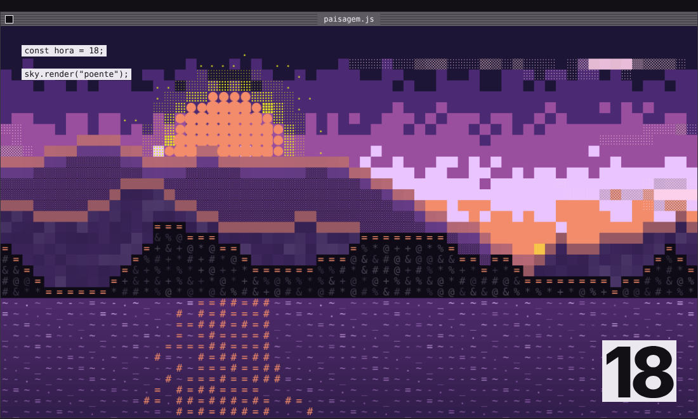
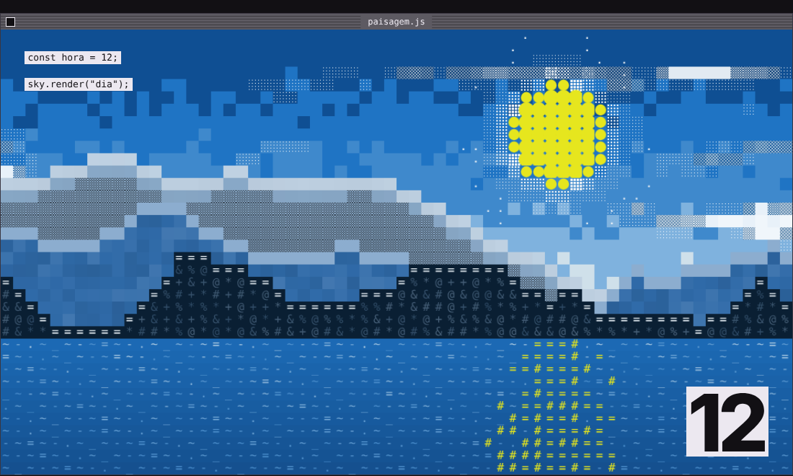
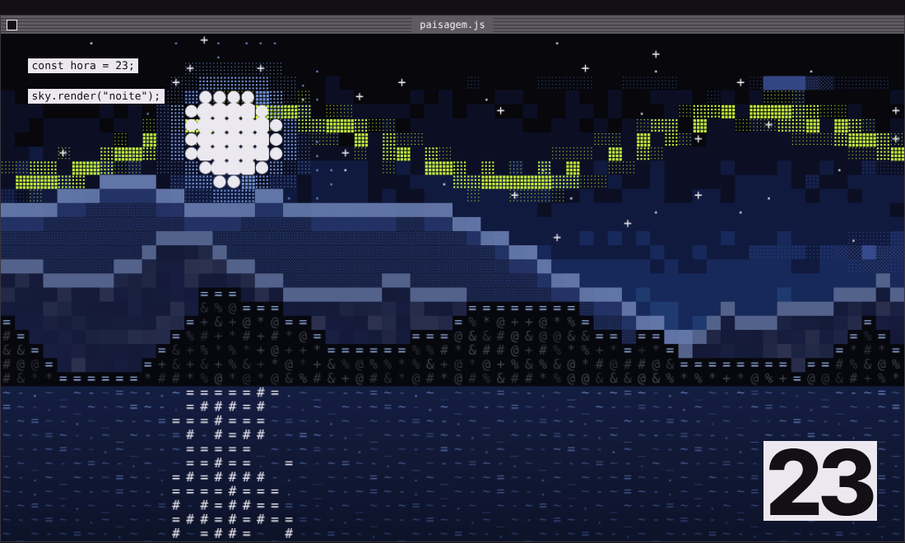

<h1 align="center">Acid Shellscape</h1>

<p align="center">
  Paisagens abstratas feitas de células de terminal.<br>
  <sub>bloco · meio-tom · pontos · caractere</sub>
</p>

<p align="center">
  
</p>

<p align="center">
  por <strong>Kevin</strong><br>
  <a href="https://github.com/k3v1nn">GitHub @k3v1nn</a>
</p>

---

**Acid Shellscape** é uma identidade visual: céu, montanhas, água ou uma foto inteira viram uma grade de quadrados, e cada quadrado é desenhado de um de quatro jeitos. O resultado parece um quadro pintado num terminal, em tons ácidos.

- **Acid**: as cores (amarelo ácido, coral, lilás, lima).
- **Shell**: a linguagem do terminal (fonte mono, caracteres, etiquetas de código).
- **Scape**: a paisagem.

| Pôr do sol | Dia | Noite |
| :---: | :---: | :---: |
|  |  |  |

## O que tem aqui

```
tokens/
  tokens.json            cores (3 temas), tipografia, espaçamento, raio
  acid-shellscape.css    as mesmas variáveis, prontas para importar
src/
  cells.js               as cinco receitas de célula (módulo ES, sem dependências)
  landscape.html         paisagem completa, 3 temas, entra por camadas
  image-to-cells.html    arraste uma imagem sua e ela vira pintura de terminal
docs/
  janelas.md             guia de design das janelas, fundos, música e várias telas
  *.png                  capturas de tela
```

## Wallpaper

A pasta [`wallpaper/`](wallpaper/) tem a paisagem como papel de parede interativo (pacote para Lively e instruções para Wallpaper Engine). Para janelas, fundos e interação, veja [`docs/janelas.md`](docs/janelas.md).

## Como ver

Abra `src/landscape.html` ou `src/image-to-cells.html` no navegador. Para servir localmente:

```sh
python3 -m http.server 8000
# http://localhost:8000/src/landscape.html
# http://localhost:8000/src/landscape.html?tema=noite
# http://localhost:8000/src/landscape.html?tema=dia&fim=1   (pula a animação)
```

## Como usar em outro projeto

**1. Cores e medidas.** Importe o CSS e escolha o tema em `<html data-theme="poente | dia | noite">` (o padrão é `poente`):

```html
<link rel="stylesheet" href="tokens/acid-shellscape.css">
```

Variáveis principais: `--ground`, `--ink`, `--ink-dim`, `--yellow`, `--coral`, `--lilac`, `--lime`, `--blue`, `--sky`, e as de cena que mudam por tema (`--sky-1` a `--sky-6`, `--sun`, `--halo`, `--cloud`, `--mtn-far`, `--mtn-mid`, `--mtn-near`, `--rim`, `--water`, `--reflection`).

**2. Células.** Desenhe em qualquer canvas 2D:

```js
import { block, halftone, dots, glyph, blob, mix, RAMP } from './src/cells.js';

const ctx = canvas.getContext('2d');
block(ctx, 0, 0, 16, '#1f74c4');                     // massa de cor
halftone(ctx, 16, 0, 16, '#0e2f52', '#ffffff', .6);  // hachura (l = luz, 0–1)
dots(ctx, 32, 0, 16, null, '#f4f6f8', .8);           // matriz de pontos
ctx.font = '15px "JetBrains Mono", monospace'; ctx.textBaseline = 'top';
glyph(ctx, 48, 0, 16, '#', '#9cc3e4', '#0e2f52');    // caractere
blob(ctx, 64, 0, 16, '#e6e61e');                     // círculo que se funde
```

**3. Paisagem pronta.** `src/landscape.html` lê as cores do CSS dos tokens: mudar uma cor em `tokens/tokens.json` (e regenerar o CSS) muda em todo lugar. A geometria de cada tema fica no objeto `SCENES` do próprio arquivo.

**4. Sua imagem.** `src/image-to-cells.html` amostra a imagem numa grade, escolhe a receita por região (ruído de baixa frequência, não por pixel) e revela por varredura de linhas.

## As quatro receitas

| Receita | Como é | Use para |
| --- | --- | --- |
| bloco | quadrado chapado | massa de cor: céu, montanha do meio |
| meio-tom | hachura diagonal cruzada; a densidade segue a luz | distância, névoa, nuvens densas |
| pontos | matriz de quadradinhos; o tamanho segue a luz | halos, nuvens leves, aurora |
| caractere | um glifo de ` .:-=+*#%@$` em JetBrains Mono | primeiro plano, água, textura de rocha |

Mais o **blob**: círculos que se sobrepõem e se fundem, a assinatura do sol e da lua.

## Princípios

- Quanto mais longe, mais leve a receita: longe é meio-tom, meio é bloco, perto é caractere.
- Movimento picotado, 10–12 quadros por segundo, e sempre por camadas. Nada de easing suave.
- Todo "aleatório" vem de `hash(coluna, linha, semente)`, nunca de `Math.random()` a cada quadro.
- Sem gradiente suave, blur, sombra ou cantos arredondados (só nos blobs).
- Texto de interface soa como código: minúsculas, mono, `const hora = 18;`.
- No máximo cinco cores de destaque por cena, e uma domina.
- Tamanhos em células, não em px: a célula sai da tela (≈90 linhas na paisagem), e só a moldura das janelas usa px.
- Dados reais viram cena (hora, sol, nuvens, chuva), mas sem rede o desenho continua.
- Reação à música mexe em raio, densidade, fase e velocidade; nunca na estrutura. Sem áudio, tudo igual.
- Ver [`docs/janelas.md`](docs/janelas.md) para janelas, fundos e interação.

## Créditos

Criado por **Kevin** ([@k3v1nn](https://github.com/k3v1nn)).

Fontes: [JetBrains Mono](https://www.jetbrains.com/lp/mono/) e [Inter Tight](https://fonts.google.com/specimen/Inter+Tight), carregadas pelo Google Fonts.

© 2026 Kevin. Todos os direitos reservados por enquanto (repositório privado; a licença será definida antes de abrir).
