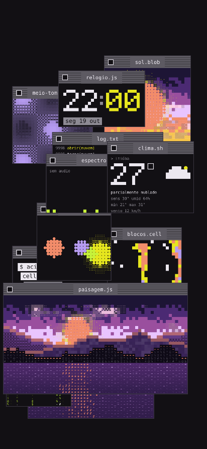

# Galeria

Variações do estilo, todas feitas com as mesmas quatro receitas de célula. As regras de cada uma estão em [janelas.md](janelas.md).

## Janelas novas

`vida.cell`, `radar.sh`, `fogo.cell`, `cobra.sh` e `sistema.sh`: interativas (um toque dá um empurrão) e autônomas (animam sozinhas).

## Estilos de barra

`mac`, `win98`, `terminal`, `beos`, `amiga` e `brutal` (mais `mix`, que sorteia um por janela).

## Paletas

`acid` (original), `fosforo`, `ambar`, `gelo`, `vapor` e `brasa`; há ainda `floresta`. A paleta recolore cena e interface.

## Temas coloridos

`neon`, `aurora`, `doce`, `deserto` e `tropical`, além de dia, poente e noite. As cores estão em [`tokens/`](../tokens/).

## Fundos

`estrelas`, `cidade`, `horizonte` e `matriz` (em ordem, da esquerda para a direita e de cima para baixo), além de `pontos`, `xadrez`, `grade`, `barras`, `paisagem` e `preto`.

## Conjuntos de janelas

`celular`, `todas`, `jogos`, `dados`, `arte`, `calma` e `nenhuma`. Aqui, `jogos` sobre a noite:

## Cenas clássicas

     
   

