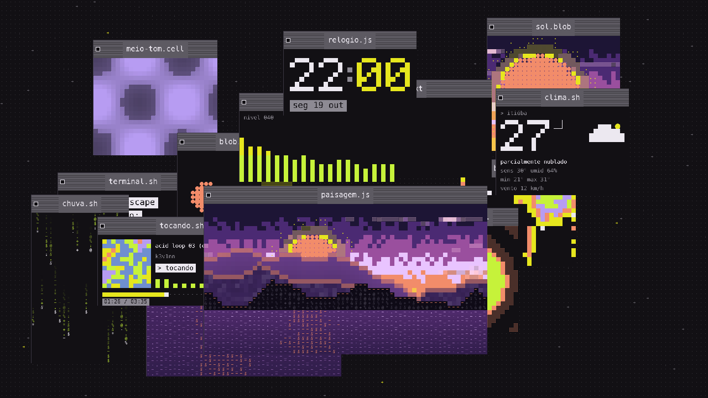
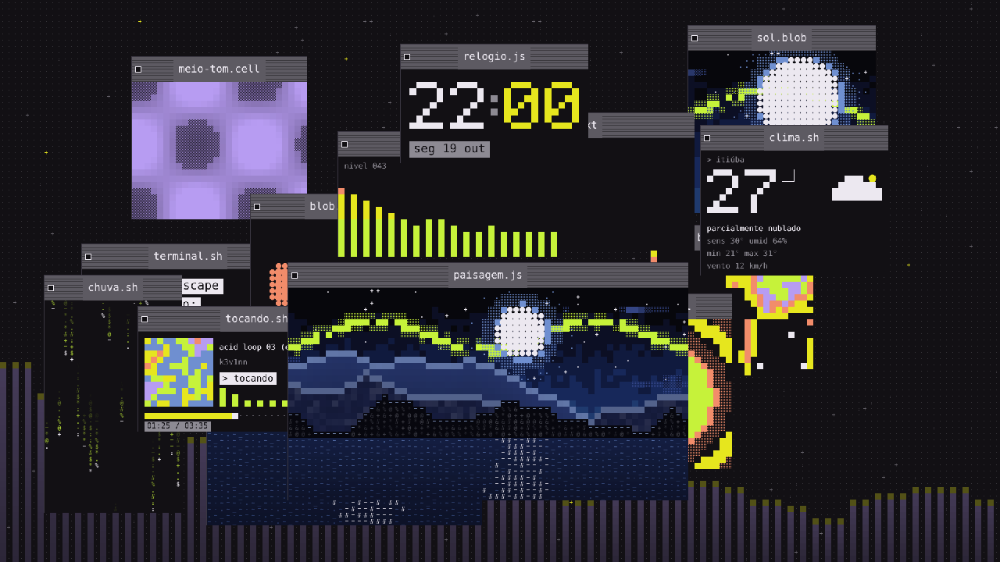
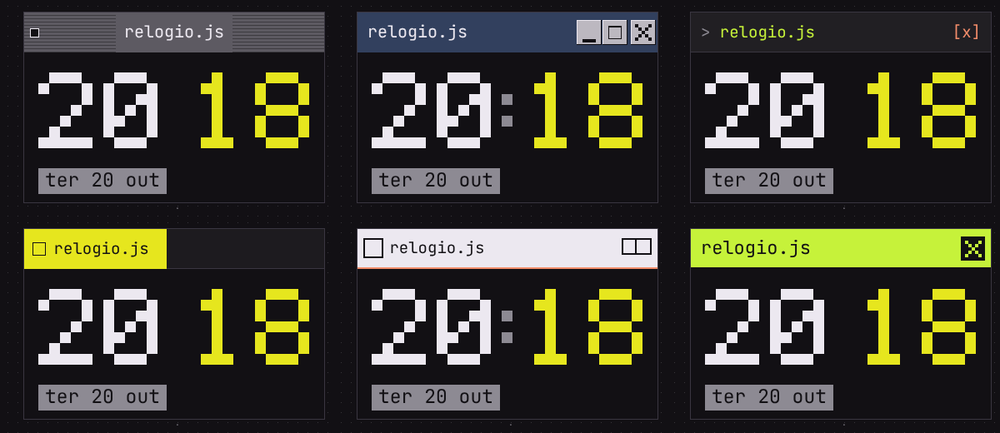
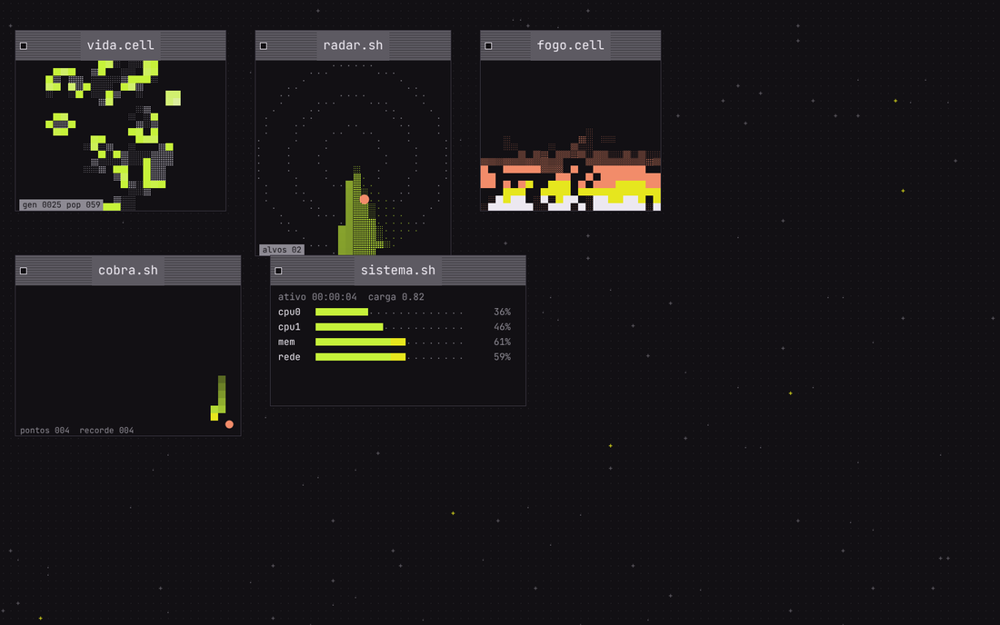
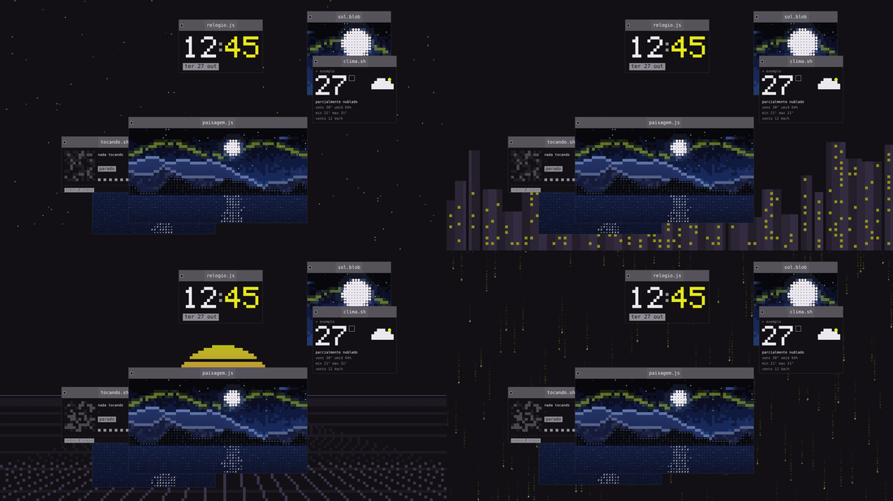
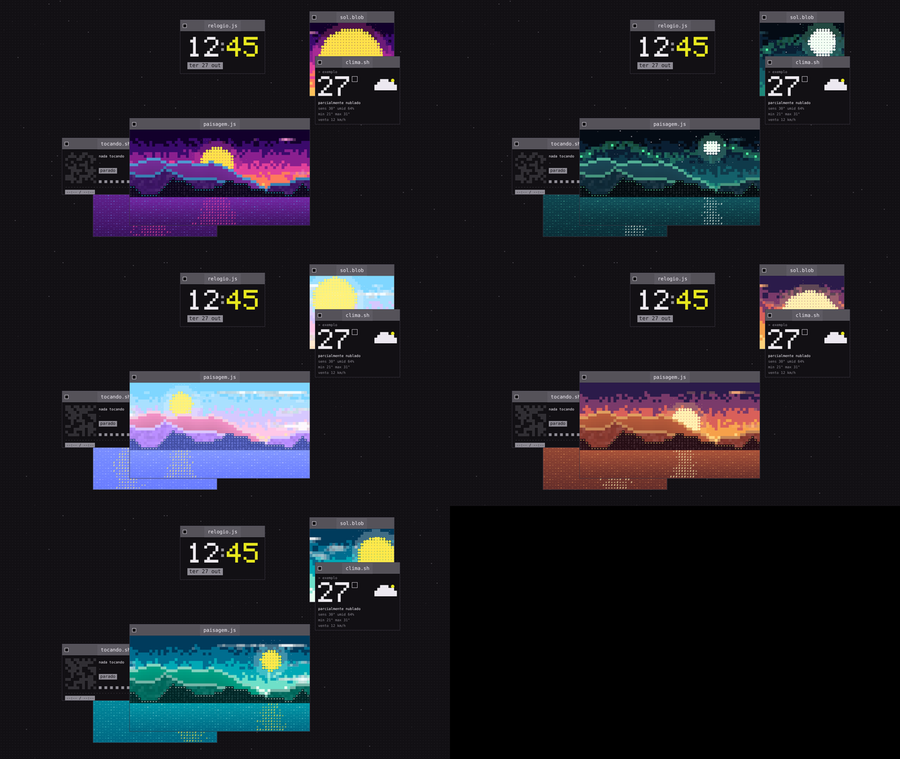
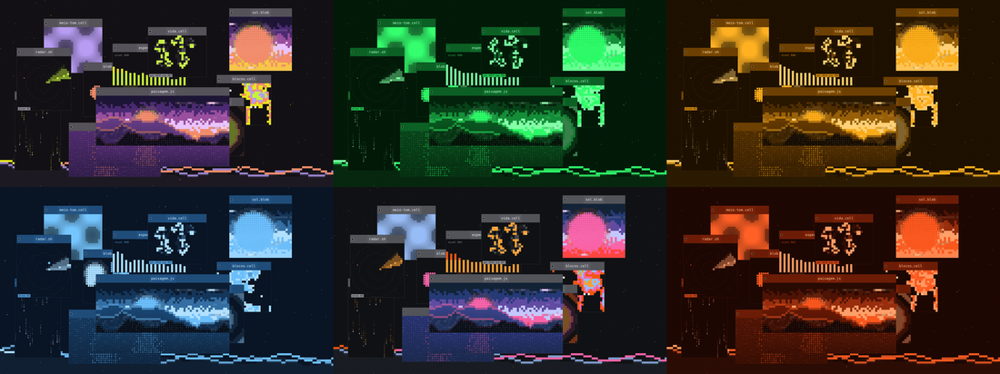
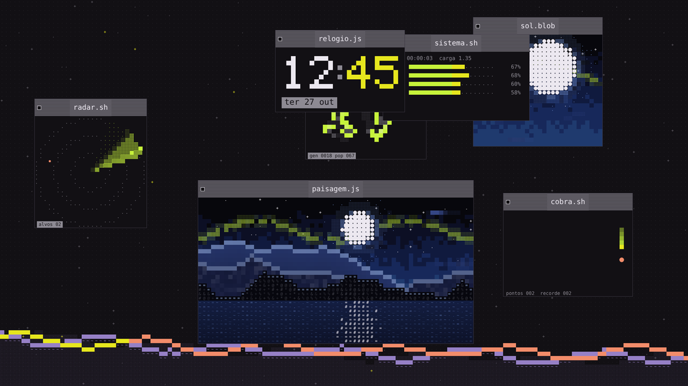

# Janelas: referência de design

As janelas de Mac clássico flutuando sobre um fundo de células são uma extensão da identidade para papéis de parede. Este guia junta o que funcionou, para reaproveitar em qualquer projeto no estilo. Tudo aqui vale junto com as regras do [README](../README.md): quatro receitas de célula, movimento em passos, sem gradiente, hash em vez de `Math.random()`. A [galeria](galeria.md) mostra as variações (estilos de barra, paletas, temas, fundos e conjuntos de janelas).

   
  

## 1. Moldura

Uma janela é uma moldura Mac clássico em volta de uma receita.

| parte | medida | cor |
|---|---|---|
| contorno | 1 px (1 px por unidade de DPR) | `line` `#3a3641` |
| corpo | o que sobra | `ground` `#121014` |
| barra de título | 4 células de altura | `chrome` `#5d5a62` |
| listras da barra | 1 px a cada 4 px, com `rgba(0,0,0,.35)` | sobre o `chrome` |
| quadrado vazado | 11 px, 7 px da borda esquerda, centrado na barra | contorno `ink`, miolo `ground` |
| título | mono, 1,7 célula, centrado, em uma placa `chrome` que interrompe as listras | `ink` |

**Estilos de barra.** A moldura Mac clássico é o padrão (`mac`), mas a barra de título (sempre 4 células de altura) tem seis estilos, todos feitos com as mesmas cores e sem gradiente. Dentro de uma janela nada muda: só a barra.

| estilo | como é |
|---|---|
| `mac` | `chrome` com listras, quadrado vazado à esquerda, título numa placa |
| `win98` | azul fundo (`blue` a 55% de preto), três botões com bisel (`_`, `□`, `x`) à direita, título à esquerda |
| `terminal` | `> arquivo.ext` em `lime`, `[x]` em `coral` à direita, barra quase preta |
| `beos` | aba `yellow` só do tamanho do título, com o quadrado à esquerda; resto da barra escuro |
| `amiga` | barra clara (`ink`) com linha `coral` embaixo, quadrado à esquerda e ícone de duas janelas à direita |
| `brutal` | barra `lime` chapada, título em `ground`, `x` em bloco à direita |
| `mix` | cada janela sorteia um dos seis por hash (`hash(janela, 11, semente)`) |

  

Etiquetas e contadores são blocos `ink` (ou `ink-dim` para o secundário) com texto `ground`. Texto solto dentro de janela é mono, minúsculo e soa como código: `nada tocando`, `sem audio`, `> tocando`, `nivel 043`. Nome de janela é `arquivo.extensão` e diz a receita: `paisagem.js`, `meio-tom.cell`, `terminal.sh`, `espectro.sh`.

Tudo se alinha à grade: posição e tamanho da janela são **inteiros de células**. A moldura é a única coisa que usa pixels.

## 2. Tamanho da célula

Não use um tamanho fixo em px. Meça a célula pela tela:

- paisagem (desktop): altura ÷ 90 linhas; retrato (celular): largura ÷ 77 colunas;
- arredonde para múltiplo de 4 (a matriz de pontos 4×4 só fecha assim) e use no mínimo 8 px;
- resultado: 1080p dá 12 px, 1440p dá 16, 4K dá 24. Todo monitor mostra janelas do mesmo tamanho relativo.

Janelas são descritas em células (`64×34` a paisagem, `30×15` o relógio) e encolhem ou crescem com a largura útil (`(colunas − 6) ÷ 66`, entre 0,5 e 1 no desktop).

## 3. Catálogo de receitas de janela

| janela | receita | detalhe que importa |
|---|---|---|
| `paisagem.js` | cena completa em camadas (céu, nuvens, sol/lua, montanhas, água) | segue o sol e as nuvens reais; fica embaixo |
| `sol.blob` | cena só com sol/lua grande | o sol respira com o grave |
| `ondas.txt` | só água de caracteres `~-=._` | fase avança com a música |
| `terminal.sh` | etiquetas de código + cursor piscando | cursor a cada 0,5 s, em passos |
| `log.txt` | linhas `0042 pintar(sol)` rolando | linhas raras em `yellow` e `lime` |
| `blocos.cell` | ruído fbm com limiar, cor por faixa | mais blocos quando está alto |
| `meio-tom.cell` | hachura com densidade em onda | grave soma luz |
| `pontos.cell` | matriz de pontos em ondas concêntricas | anel `yellow` a cada batida |
| `chuva.sh` | colunas de caracteres caindo, cabeça `ink`, cauda `lime` → `ground` | acelera com o volume |
| `blob.js` | quatro círculos que se fundem | crescem com o grave |
| `espectro.sh` | 18 barras de 1 célula com 1 de vão; `lime` → `yellow` → `coral` por altura; topo `-` em `ink` | sem áudio: faíscas de 1 célula |
| `tocando.sh` | capa 11×11 células (6 níveis por canal), título rolando em passos de caractere, barra de progresso | capa sem gradiente: amostrada e quantizada |
| `clima.sh` | temperatura em dígitos 5×7, ícone de 8×7 células, linhas de dados | ver abaixo |
| `relogio.js` | `HH:MM` em dígitos 5×7, minutos em `yellow`, dois pontos piscando, data em etiqueta | não se mexe |
| `vida.cell` | Jogo da Vida em grade de blocos `lime` que esfriam para `ink` com a idade; célula que morre deixa um ponto-fantasma | rótulo `gen 0025 pop 059`; parado ou morto por 14 passos, nasce outra população por hash |
| `radar.sh` | disco com anéis e cruz de `.` e `:`, varredura `lime` que deixa rastro em blocos, pontos de blob `coral` | a varredura acelera com o volume; alvo novo a cada ~2,6 s |
| `fogo.cell` | propagação de calor de baixo para cima, 5 faixas: pontos → meio-tom → bloco `coral` → `yellow` → `ink` | grave alimenta a base |
| `cobra.sh` | cobra de blocos `lime` (cabeça `yellow`) que persegue um blob `coral`; vira `coral` ao reiniciar | rótulo `pontos 004  recorde 004`; joga sozinha |
| `sistema.sh` | barras `cpu0..3`, `mem`, `rede` em `lime` → `yellow` → `coral`, ou o histórico da carga | cabeçalho `ativo 00:00:04  carga 0.82`; números inventados por ruído, não leem o sistema |
| `agenda.txt` (Android) | calendário do mês, domingo em `coral`, hoje em bloco `ink` | só existe como widget |
| `bateria.sh` (Android) | só como widget: porcentagem em dígitos 5×7 e linha `> carregando` / `> na bateria` | `lime` > 50%, `yellow` > 20%, `coral` abaixo |

**Dígitos de bloco.** Relógio e temperatura usam uma fonte de pixels 5×7 (cada pixel é um quadrado de uma ou duas células). Número grande nunca usa a fonte mono.

  

**Ícones de clima** são feitos com as receitas: nuvem de blocos, sol de blob + pontos, lua de blob recortado, chuva de `|`, neve de `*`, tempestade de `/` em `yellow`, neblina de `=`.

## 4. Camadas e faixas

Três camadas de desenho: normal (0), paisagem (1) e sempre por cima (2: relógio e clima). Tocar numa janela a traz para a frente **da própria camada**; nada passa por cima do relógio. Cada janela vive numa faixa vertical da área útil (relógio e clima no alto, paisagem embaixo) e nunca encosta no topo (mínimo de 12% das linhas no retrato, 4% na paisagem) nem no fundo.

## 5. Movimento

- 10 fps é o padrão e a cara do estilo. O wallpaper aceita de 5 a 60 fps para quem quiser mais fluidez, mas o movimento continua em passos de célula, e a animação interna das janelas (que é redesenhada em cache) fica em no máximo 20 por segundo. O que não é frame é hash do frame.
- Janelas flutuam devagar (0,15 a 0,55 célula por segundo), batem nas bordas e voltam; abrem e fecham por **dithering de hash** (`hash(c, r, seed) < q`), nunca por fade; ficam abertas 16 a 42 s e reabrem noutro lugar. Dá para desligar o ciclo (as janelas ficam fixas) e escolher a **quantidade** de janelas (0 = a do conjunto).
- Parallax: no máximo **uma célula por frame**, cada janela com sua profundidade.
- Troca de tema (dia → poente → noite): dithering por célula em 3,2 s, com os mesmos limiares da abertura.
- Tocar: anel de caracteres (`@%#*+=-:.`) que se abre em 16 frames, e a janela tocada inverte a velocidade.

## 6. Dados reais viram cena

A paisagem não é um tema fixo: ela lê o mundo (Open-Meteo, sem chave).

- Dia é entre `nascer + 1,5 h` e `pôr − 0,5 h`; poente vai de `nascer − 0,5 h` a `pôr + 2 h`; o resto é noite.
- O corpo (sol ou lua) percorre um arco entre `nascer − 0,5` e `pôr + 2`.
- Nuvens: o limiar do ruído sobe e desce com a cobertura (`(0,5 − cobertura) × 0,3`; neblina −0,1).
- Chuva: sobreposição de `|` por nível (garoa 1, chuva 2, trovoada 3) sobre o céu da paisagem.
- Sem rede: nascer 5h30, pôr 17h30, sem chuva. O clima nunca bloqueia o desenho.

## 7. Música

Cada janela pode reagir ao áudio, mas só mexe em **raio, densidade, fase ou velocidade**. Nunca muda a estrutura da receita.

- Espectro: 64 valores (esquerda e direita em média) → 32 bandas, `pow(v, 0,7)`; subida imediata, descida `×0,78`; picos caem 0,08 por frame.
- Batida: grave acima de `1,25 ×` a média móvel (`+0,05`), mínimo de 220 ms entre batidas.
- Sem áudio ou volume zero, as janelas ficam exatamente como sem a função. Teste com música de mentira antes (`&audio=demo` no wallpaper web).
- Metade da música é meta: título, artista e progresso com **tempo extrapolado** entre as atualizações do sistema.

## 8. Fundos (desktop)

Atrás das janelas, nunca competindo com elas. A parte parada é pintada uma vez num canvas fora da tela; por quadro só se desenha o que se mexe.

| fundo | o que é |
|---|---|
| `pontos` | um ponto por célula em `ground` + 30% de `ink-dim`; faíscas `+` e `.` por hash |
| `xadrez` | células alternadas 3,5% mais claras; faíscas em blocos de acento a 16%; uma linha varrendo |
| `grade` | linhas de `line` a cada 8 células, cruzes nas interseções |
| `barras` | `pontos` + colunas de espectro nascendo de baixo (16–32% de acento, topo em `yellow`) |
| `preto` | só `ground` (`#000` para OLED) |
| `estrelas` | poeira de `+` e `.` que pisca por hash; algumas em `yellow` |
| `cidade` | skyline de blocos em `ground` mais claro, janelinhas `yellow` acesas por hash, chuva fina de pontos embaixo |
| `horizonte` | sol de bandas (blobs em `yellow`) nascendo atrás de uma grade em perspectiva |
| `matriz` | colunas de caracteres caindo em `lime` bem escuro, uma cabeça `yellow` por coluna |
| `paisagem` | a própria paisagem em tela cheia, com tudo atrás das janelas |

  

Regra: fundo nunca passa de uns 30% do brilho de uma janela, e as faíscas crescem com o volume (0,6% das células em silêncio, até 2,6% no máximo).

## 9. Interação (desktop)

- Arrastar pela barra de título; a janela **encaixa na grade** (posição em inteiros de células) e fica onde foi solta. Clique duplo na barra a faz flutuar de novo. O quadrado vazado fecha (ela reabre noutro lugar).
- A janela largada fica sempre dentro da tela, ao contrário do fluxo normal, que respeita as faixas.
- Cursor: `grab` sobre barra de título, `grabbing` arrastando.
- **Tocar dentro do conteúdo** faz a janela reagir, sem mudar a receita: `vida.cell` solta um R-pentomino virado ao acaso, `cobra.sh` põe a comida onde você tocou, `fogo.cell` acende um círculo de calor, `radar.sh` marca um alvo `yellow`, `sistema.sh` alterna entre barras e histórico. As janelas de receita (`blocos`, `meio-tom`, `pontos`) também reagem ao toque. Tocar na barra continua trazendo a janela para a frente.
- Fundos também respondem ao toque fora das janelas: `estrelas` solta uma estrela cadente, `cidade` troca o turno das luzes, `horizonte` pisca a grade em `yellow` e `matriz` solta uma coluna de caracteres, no espírito do anel de caracteres.

## 10. Várias telas

- Um papel por monitor: a célula automática resolve resoluções diferentes. Dois monitores iguais sorteiam arranjos iguais; uma `semente` por monitor resolve.
- Papel esticado por 2 ou 3 monitores (proporção acima de 2,4): um conjunto de janelas por tela, cada janela presa à sua tela.

## 11. Cores dentro das janelas

Os tokens de interface valem como em qualquer projeto. Dentro dos wallpapers, quando o texto está sobre canvas e não sobre CSS, usamos os acentos mais saturados abaixo (já estão em `tokens/`):

| uso | token | valor |
|---|---|---|
| lilás de bloco e meio-tom, em fundo escuro | `lilac-ui` | `#b79cf2` |
| azul de chuva e halo da noite | `blue-ui` | `#6f8fd0` |
| texto secundário sobre canvas | `ink-dim` | `#9a97a1` (os wallpapers usam `#8d8a93`, ligeiramente mais escuro) |

Um acento domina por janela; no máximo cinco na tela.

## 12. Temas coloridos

Além de dia, poente e noite (que o wallpaper escolhe sozinho pela hora), existem cinco temas escolhidos à mão. Eles não seguem a hora: o corpo (sol ou lua) fica numa posição fixa e a cena é sempre a mesma. As cores estão em `tokens/` (`data-theme="neon | aurora | doce | deserto | tropical"`).

| tema | clima | céu | corpo | destaque |
|---|---|---|---|---|
| `neon` | synthwave | roxo → rosa → laranja | `yellow` grande, no meio | aresta `ciano` `#35e8ff` |
| `aurora` | noite polar | azul-petróleo → verde-água | lua pequena e alta | véu `#4dffa0` e estrelas |
| `doce` | tarde de algodão-doce | azul-bebê → pêssego | sol `#fff27a` | montanhas rosa e lilás |
| `deserto` | fim de tarde seco | roxo → vermelho → ouro | sol claro, baixo | aresta `#ffd27a` |
| `tropical` | mar claro | azul-escuro → turquesa → menta | sol `#ffe94a` | aresta `#e8fff0` |

  

Regras para criar um tema novo: cinco ou seis faixas de céu (a última pode repetir), três montanhas do mais claro (longe) ao mais escuro (perto), uma `rim` que contraste com as montanhas, `water` entre `bg` e `hi`, e no máximo cinco cores de destaque. Tema claro (como `doce`) é aceitável, mas as janelas continuam escuras por dentro.

## 13. Paletas

A paleta recolore **tudo** (cena e interface) a partir das cores-base, sem mexer na estrutura. Duas famílias:

- **rampa de luminância** (monitor de fósforo): a luminância de cada cor vira uma posição numa rampa de 4 pontos. `fosforo` (verde), `ambar`, `gelo` (azul), `brasa` (laranja/vermelho).
- **rotação de matiz**: gira o matiz mantendo a saturação. `vapor` (rosa, roxo e azul) e `floresta` (verdes e roxo).
- `acid` é o original (sem recolorir).

  

Tema e paleta se combinam: o tema escolhe a cena, a paleta troca as cores. Para o resultado mais coerente, use `fosforo`/`ambar`/`brasa` em cenas escuras (poente, noite, aurora) e `vapor`/`floresta` em qualquer uma.

## 14. Conjuntos de janelas

Um **conjunto** diz quais janelas existem. A quantidade pedida ajusta o conjunto (relógio, clima e paisagem têm prioridade; sobrando, repete receitas).

| conjunto | janelas |
|---|---|
| `celular` / padrão | as 12 originais (paisagem, sol, terminal, ondas, blocos, meio-tom, pontos, chuva, log, blob, clima, relógio) |
| `todas` | todas as janelas, inclusive as de música e as interativas |
| `jogos` | paisagem, sol, vida, cobra, fogo, radar, sistema, relógio |
| `dados` | paisagem, sol, terminal, log, tocando, clima, relógio, sistema |
| `arte` | paisagem, sol, ondas, blocos, meio-tom, pontos, chuva, blob, espectro, vida, fogo, radar |
| `calma` | paisagem, sol, ondas, tocando, clima, relógio |
| `nenhuma` | nada: só o fundo (e, no Android, só as ondas se estiverem ligadas) |

  

## 15. Ondas de música

Opcional, independente das janelas: uma faixa de ondas de blocos na parte de baixo da tela que reage ao áudio (`ondas` ligada/desligada). Mesmas regras da seção 7: só raio, fase e velocidade. Ela só aparece quando há música tocando e some sem áudio.

## 16. Android (widgets, bloqueio e posições)

Detalhes que valem só no app de celular:

- **Dois papéis de parede**: o app registra um serviço para a tela de bloqueio e outro para a tela inicial/launcher, cada um com seu próprio conjunto de ajustes (tema, célula, fundo, janelas, barra, paleta, quantidade). Isso permite, por exemplo, `neon` com `todas` no bloqueio e `preto` com `nenhuma` atrás dos apps.
- **Editor de posições**: arrastar as janelas numa prévia e salvar. A posição é guardada em frações da tela e continua encaixando na grade de células.
- **Widgets**: há seis widgets (relógio, clima, tocando, paisagem, agenda e bateria), cada um uma janela. São bitmaps desenhados pelas mesmas receitas, com a moldura escolhida, e uma margem transparente em volta para os cantos arredondados do launcher não cortarem a borda. O tamanho do widget define a célula (a maior que cabe), e o conteúdo é redesenhado nessa grade em vez de esticado.
- **Música real**: forma de onda via `Visualizer` (precisa da permissão de microfone/áudio) e título, artista e progresso via sessão de mídia (acesso a notificações). Sem permissão, as janelas ficam como sem áudio.
- **Bateria**: a animação roda a no máximo 20 por segundo e o fundo `paisagem` em tela cheia é o que mais gasta; para economizar, use `preto`, `pontos` ou `nenhuma`.

> Estado: o app Android é compilado por CI, mas ainda não foi testado em aparelho real; trate os itens acima como projeto.

## 17. O que evitar

- Fade, easing, blur, sombra, gradiente (o "gradiente" é sempre bandas de células).
- Tamanhos em px para conteúdo; só moldura e quadrado vazado usam px.
- Aleatório por frame: tudo é `hash(coluna, linha, semente)`.
- Texto de interface em maiúsculas ou em frases longas. Prefira `sem audio` a "Nenhum áudio detectado".
- Reagir à música alterando estrutura, ou deixando o fundo chamar mais atenção que a janela.
- Janela interativa que depende de toque para fazer sentido: `cobra`, `vida`, `fogo` e `radar` jogam e animam sozinhas; o toque só dá um empurrão.
- Dados "de sistema" que parecem reais mas são inventados: `sistema.sh` é cenário; deixe isso claro no texto da janela (`carga`, não `cpu real`).
- Paleta que apague contraste: texto `ground` sobre `ink`/acento precisa continuar legível depois da recoloração.
